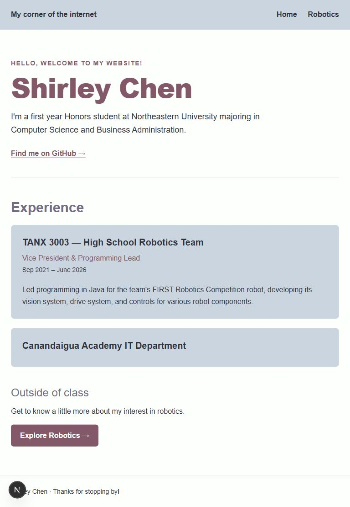
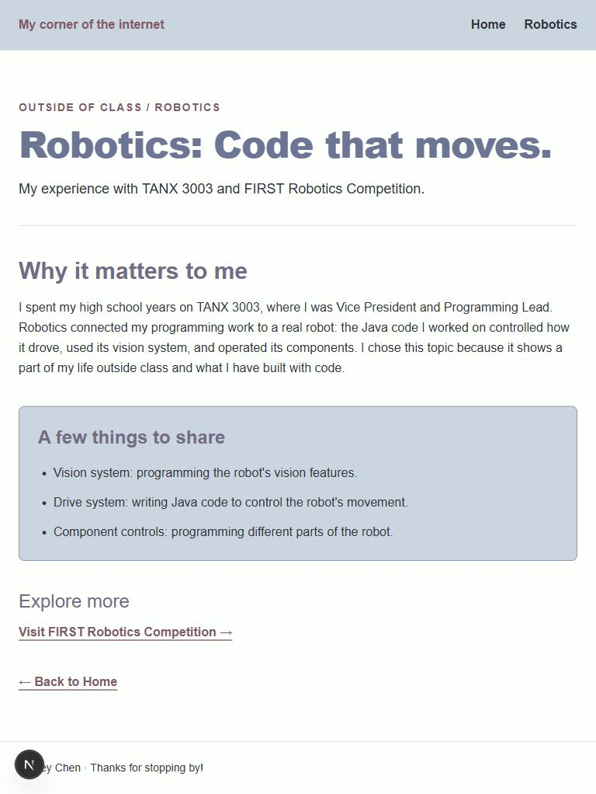

# Homework 2 submission

Draft reflection: review and adjust this to match what you learned before submitting.

## What I learned

This week I learned how to split a website into smaller sections using headings, paragraphs, lists, and links. I practiced changing spacing, colors, and font weights with Tailwind classes. Different heading weights help show which information is most important. I also learned that checking the actual page in a browser matters because code alone does not show how the layout looks.

## Next.js vs raw HTML/CSS

With raw HTML and CSS, I would create separate HTML files and link a stylesheet. Next.js lets me write pages as React components. A folder with a page.tsx file creates a route. The shared layout keeps my navigation on both pages without copying it into each file.

## How the tools fit together

React builds the page using components and JSX, which looks similar to HTML. TypeScript adds type checking to JavaScript and helps catch mistakes. Tailwind provides classes for styling. Next.js puts these tools together and handles routes and rendering. My profile text is stored in one simple object so it is easy to update.

## My interest page

My draft interest page is about robotics. I chose it because my starter already described my work with TANX 3003. The page includes a short story, a list of programming work, and a link to FIRST Robotics Competition.

## Screenshots

### Home

### Interest

## Project location

The project is at `02-frontend/hw/mywebsite`.

## Checks

- Home includes a name, bio, GitHub link, and Tailwind styling.
- Both pages share Home and Robotics navigation using Next.js Link.
- `/interest` includes a title, story, list, external link, and Home link.
- Verified Home → Robotics → Home in the running development server.
- TypeScript checking passes.
- No nested `.git` exists; `node_modules` and `.next` are ignored.
- Production build currently fails in the existing Turbopack CSS worker setup; the development pages render successfully.
- Commit and push are still pending.

## AI assistance

I used Codex to help draft the pages, styling, editable profile content, and this reflection, and to check navigation. I should review the draft and be able to explain the code before submitting.

## Optional: deploy link

Not deployed.
